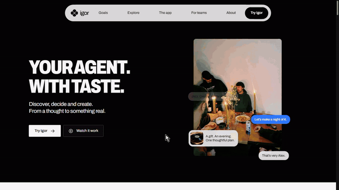
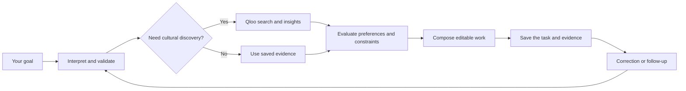
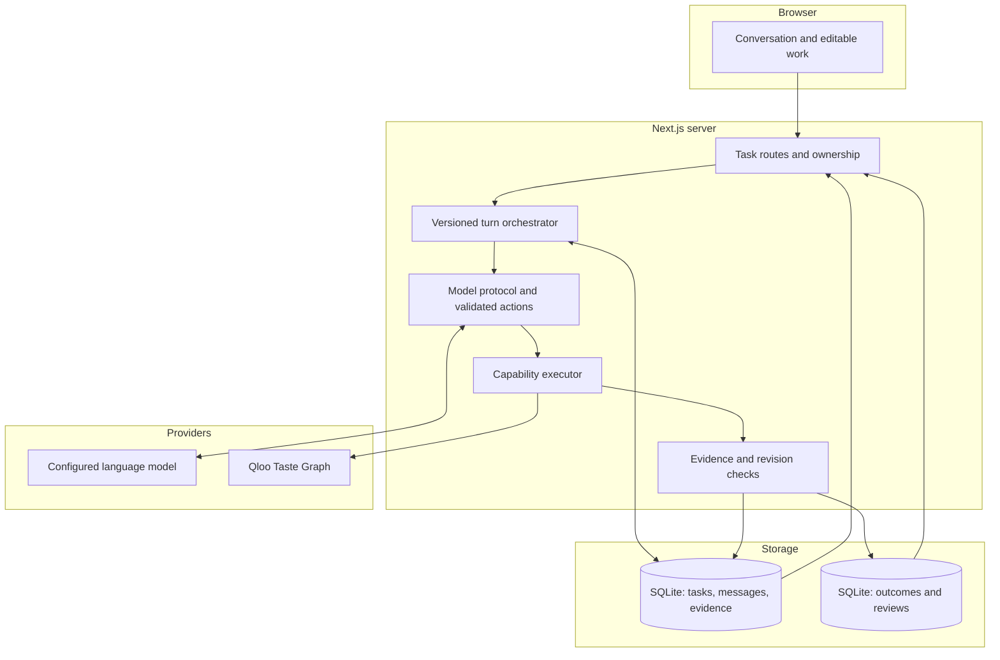
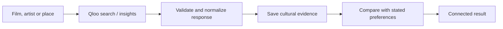
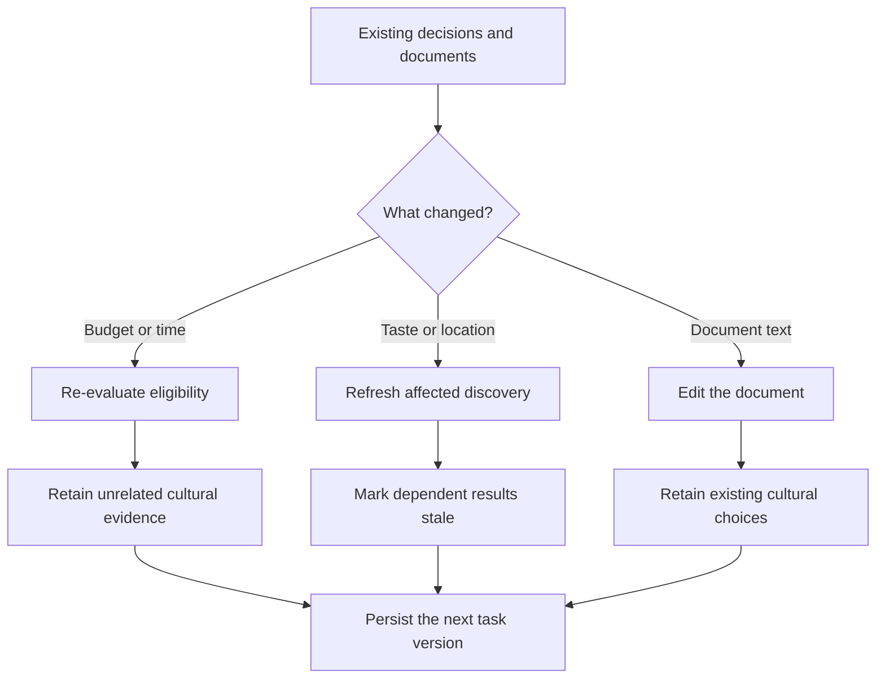

# Igor

[](https://github.com/Davemafy/igor-agent/actions/workflows/ci.yml)

<p align="center">
  <a href="assets/Screen%20Recording%202026-10-31%20035320.mp4">
    
  </a>
</p>

<p align="center"><sub>Real product footage · looping silent preview · <a href="assets/Screen%20Recording%202026-10-31%20035320.mp4">Play the complete video with audio</a></sub></p>

**Most AI gives you recommendations. Igor turns cultural intelligence into decisions, connected work, and plans that can change with you.**

**Watch the walkthrough:** [Igor product screen recording (MP4)](assets/Screen%20Recording%202026-10-31%20035320.mp4) · **Explore Qloo:** [Integration, evidence and evaluation](qloo/README.md) · **Try it:** [Live app](https://igor-production-243e.up.railway.app/app)

Meet Igor, your agent with taste. Start with a film, an artist, a place or a feeling. Powered by Qloo's Taste Graph, Igor helps you discover what fits, compare preferences, and turn a conversation into an editable plan, invitation, itinerary or creative brief. When things change, your decisions and work can carry forward.

- **Judge path:** [Try a film discovery, revise the budget, inspect saved work](#judge-walkthrough)
- **Verified production run:** [October 26 Railway checks](docs/live-integration.md), including a LIVE Qloo retrieval and a correction with no new Qloo calls
- **Supported outcomes:** [What Igor can actually produce](docs/broader-outcomes.md)

---

> **Release evidence:** The October 26 Railway Qloo session below is a documented historical production test, not proof that every current model configuration or this exact source revision passes live acceptance. The public repository excludes rights-restricted Qloo recordings; its archived replay suites are not reported as passing. The demo video is an actual screen recording, not evidence of an authenticated live provider test at this commit.

## Contents

- [The problem](#the-problem)
- [What Igor does](#what-igor-does)
- [How it works](#how-it-works)
- [Architecture](#architecture)
- [The conversation loop](#the-conversation-loop)
- [The Qloo loop](#the-qloo-loop)
- [The revision engine](#the-revision-engine)
- [What the model does, and what it never does](#what-the-model-does-and-what-it-never-does)
- [Safeguards](#safeguards)
- [The verified production run](#the-verified-production-run)
- [Judge walkthrough](#judge-walkthrough)
- [Screens](#screens)
- [Data model](#data-model)
- [Tech stack](#tech-stack)
- [Running it yourself](#running-it-yourself)
- [Testing](#testing)
- [Project layout](#project-layout)
- [Known limitations](#known-limitations)
- [License](#license)

---

## The problem

It's easy to ask AI for ten good films, ten interesting places or ten things to do with friends.

It's harder to agree on one, check whether it fits everyone, turn it into an actual plan, and change the plan later without losing what was already decided.

Recommendations usually stop at the list. Chatbots can write a plan, but the cultural references, people's preferences, practical constraints and editable documents often end up disconnected.

## What Igor does

Igor connects **discovery to decisions to saved work**, all in one conversation.

You can start with an artist or film you love, find related references through Qloo, compare what works for different people, and turn the result into an editable outcome. You can then continue the same conversation instead of starting the task over.

| What you ask | What Igor can produce |
|---|---|
| "Find films for a quiet evening. I love Portishead and Arrival." | Cultural references with Qloo-linked evidence |
| "Help six friends agree on an evening." | Individual preference trade-offs, a programme and an editable invitation |
| "Plan three days in Tokyo." | A structured itinerary using supplied planning facts |
| "Build a listening programme around these artists." | Artist-level segments and transitions |
| "Turn these references into a creative direction." | An editable brief with references and open questions |

All of these use the same four capabilities: **Discover, Evaluate, Collaborate and Compose**. They are not separate assistants.

The important boundary:

> **Qloo helps Igor understand cultural fit. The agent and application turn that into a decision you can revisit.**

Qloo does not verify venue opening hours, real-time availability or your budget for you. Igor keeps those questions separate from cultural affinity.

## How it works



1. **Describe the goal.** Start with a normal message, not a menu of specialized tools.
2. **Interpret and validate.** The model proposes a response or actions; the server validates ownership, task version, action type and required inputs.
3. **Discover only when needed.** Qloo retrieves cultural references. Previously saved results can be reused for changes that do not affect discovery.
4. **Evaluate and compose.** Igor checks known practical details, keeps uncertainty visible, and produces work tied to its references.
5. **Carry the work forward.** The next turn sees the saved conversation, choices, documents and dependencies.

The user doesn't have to decide which capability to call. [The orchestrator](src/core/orchestrator.ts) and [capability registry](src/capabilities/registry.ts) handle that boundary.

## Architecture

One Next.js App Router application hosts the conversation, server-side provider adapters, capability engine and persisted workspace.



The UI and engine use the same typed task contracts. UI components do not independently decide which cultural references are eligible or which work goes stale.

### Where each part fits

| Component | Job | Source |
|---|---|---|
| **Next.js / React** | The conversation, results and editable workspace | [`src/app/`](src/app/), [`src/components/`](src/components/) |
| **Model adapter** | Interpret turns and propose structured actions | [`src/tools/turn-protocol.ts`](src/tools/turn-protocol.ts) |
| **Agent orchestrator** | Execute a versioned turn and preserve context | [`src/core/orchestrator.ts`](src/core/orchestrator.ts) |
| **Capability engine** | Discover, Evaluate, Collaborate, Compose | [`src/capabilities/`](src/capabilities/) |
| **Qloo** | Cultural retrieval and evidence | [`src/tools/qloo-live.ts`](src/tools/qloo-live.ts) |
| **SQLite** | Persist conversations, tasks, references and edits | [`src/data/`](src/data/) |

[Architecture notes](docs/architecture.md) contain the ownership, evidence and failure contracts.

## The conversation loop

The thread is not just a transcript. It is connected to the task's decisions and saved work.


A follow-up can refer back to earlier interests, constraints and documents. Version checks prevent stale writes from silently replacing newer changes. A failure should preserve existing work rather than fabricating a successful provider result.

Read [task lifecycle](docs/architecture.md), [turn orchestration](src/core/orchestrator.ts) and [connected-work verification](docs/connected-work-validation.md).

## The Qloo loop

Qloo supplies the cultural layer, not a finished schedule or an answer to every practical question.



- **Retrieval:** The live adapter uses fixed Qloo API endpoints, including `/search` and `/v2/insights`.
- **Provenance:** Igor keeps provider identity, entity references, retrieval status and limitations.
- **Caching:** A cached result is labeled `CACHED`; it is not passed off as a fresh `LIVE` response.
- **Practical facts:** A cultural association does not confirm costs, opening hours, rights, travel times or availability.

The [`qloo/`](qloo/README.md) directory gives judges one place to inspect [workflow](qloo/WORKFLOW.md), [evidence](qloo/EVIDENCE.md) and [evaluation methodology](qloo/EVALUATION.md).

## The revision engine

Igor tries to change what depends on a correction, not regenerate everything.



Budget changes can reuse a discovered reference pool. A changed artist or city can require new cultural evidence. A wording edit should not erase approved choices.

The same dependency model links preferences, facts, candidates, evidence and artifacts. [Revision implementation](src/core/revision.ts) and [connected-work validation](docs/connected-work-validation.md) document the tested boundaries.

## What the model does, and what it never does

| Model-driven | Code-enforced |
|---|---|
| Understand the user's goal and conversation | Validate structured actions, permissions and task versions |
| Propose cultural directions and explain results | Retrieve Qloo evidence through bounded server-side adapters |
| Suggest a plan or edit | Check practical eligibility, source validity and affected dependencies |
| Compose natural-language work | Persist documents, decisions, reviews and changes |

The model does **not** grant itself new tools or permissions. A statement about taste does not become a verified venue fact merely because the model is confident.

This boundary is enforced through [typed contracts](src/core/contracts.ts), [capability contracts](src/capabilities/contract.ts), and the [execution pipeline](src/core/execute-plan.ts). It does not imply that every model-written sentence has been independently fact-checked.

## Safeguards

| Invariant | Behavior |
|---|---|
| **Missing practical facts stay unknown** | No invented confirmed price or opening time |
| **Provider failure is not a recommendation** | Preserve work and report an error or partial outcome |
| **A cache hit is not a fresh call** | Delivery status remains explicit |
| **Different people keep different tastes** | Preferences are attributed; missing affinity is not dislike |
| **A correction has a scope** | Dependent work changes; unrelated edits are retained |
| **No silent external actions** | No automatic booking, purchase or invitation send |

These describe documented application contracts and covered cases, not a guarantee that every fresh production request will succeed.

## The verified production run

The Railway checks recorded on **October 26, 2026** exercised a configured Gemini and Qloo runtime.

| Turn or check | Observed result |
|---|---|
| "I like Portishead and Arrival. Find films for me for a quiet evening." | **10 film references**, **LIVE** Qloo evidence |
| Initial cultural retrieval | **2 Qloo requests**, **1 model request** |
| "Budget: 20" | Constraint updated; reference pool retained |
| Qloo calls for the budget correction | **0** |
| Separate thread-continuity check | Previous context recalled; stored messages restored |

The production check shows a real retrieval and a selective correction in those tested circumstances. It is **not** a completed comparative study of how much Qloo improves user satisfaction, nor a fresh pass on every later commit.

**Evidence:** [live integration report](docs/live-integration.md) · [Qloo-specific observations](qloo/EVIDENCE.md) · [verification metadata](docs/verification.json).

## Judge walkthrough

1. Open the [live application](https://igor-production-243e.up.railway.app/app).
2. Ask: `I like Portishead and Arrival. Find films for me for a quiet evening.`
3. Inspect the references and whether their evidence is `LIVE` or `CACHED`.
4. Say `Budget: 20`. Look for the updated constraint and retained references.
5. Reload the conversation and ask Igor to recall your original request.
6. Compare what happened with the [dated production log](docs/live-integration.md) and [Qloo evidence](qloo/EVIDENCE.md).

This is a walkthrough of the real app, not a dedicated `/judges` route or a guaranteed replay of historical responses.

## Screens

The full product walkthrough is included in this repository: [watch the uploaded MP4](assets/Screen%20Recording%202026-10-31%20035320.mp4).

## Data model

SQLite stores task state, conversations, evidence, selected references and version information. Connected documents, collections and reviews are maintained alongside those tasks.

| Data | Why it exists |
|---|---|
| **Conversation and task** | Carry the user's goal and earlier context between turns |
| **Participant preferences** | Preserve who said what, without inventing a group consensus |
| **Evidence and candidates** | Keep cultural sources and practical claims traceable |
| **Decisions and dependencies** | Make selective revision possible |
| **Documents and reviews** | Save user-editable work and its revisions |

The authoritative schemas are in [`src/core/contracts.ts`](src/core/contracts.ts) and [`src/data/`](src/data/).

## Tech stack

| Area | Technologies |
|---|---|
| Frontend | Next.js App Router, React, TypeScript |
| Agent | Typed capability contracts, validated model actions and orchestration |
| Cultural intelligence | Qloo Taste Graph |
| Model providers | Configurable model adapters, including Gemini |
| Persistence | SQLite |
| Validation and tests | Zod, Vitest, Playwright |

## Running it yourself

Requires **Node.js 24+**.

```bash
git clone https://github.com/Davemafy/igor-agent.git
cd igor-agent
npm ci
```

Configure a supported model provider and Qloo key in the **server environment** (not in `NEXT_PUBLIC_` variables). For example:

```dotenv
QLOO_API_KEY=your_key
GEMINI_API_KEY=your_key
```

```bash
npm run dev
```

Open [http://localhost:3000/app](http://localhost:3000/app). See [development setup](docs/development.md) for additional providers and persistent-storage requirements.

## Testing

```bash
npm test
npm run test:eval
npm run typecheck
npm run lint
npm run build
```

`npm run test:eval` tests Igor's blind-evaluation tooling. It does **not** report a completed human study or measured Qloo advantage.

Original Qloo response recordings are omitted from the public repository because redistribution rights are unresolved. Replay-dependent suites cannot run from this sanitized checkout without authorized fixtures.

[Test configuration](tests/vitest.config.mts) · [Provider checks](docs/github-validation.md) · [Evaluation protocol](qloo/EVALUATION.md).

## Project layout

```text
src/
  app/            Pages, workspace and server routes
  components/     Conversation and editable interface
  core/           Orchestrator, evidence, task state and revision
  capabilities/   Discover, Evaluate, Collaborate, Compose
  tools/          Qloo and model provider adapters
  data/           SQLite task and outcome storage
qloo/             Integration, evidence and evaluation
tests/            Unit and browser suites
scripts/          Checks and evaluation tools
docs/             Architecture and recorded verification
```

## Known limitations

- Igor does not automatically book venues, send invitations or make purchases.
- A cultural association is not a verified live price, schedule, availability or proof of personal preference.
- The live app can depend on current provider configuration and quota.
- Public replay tests require third-party recordings not distributed here.
- Historical production checks don't establish current end-to-end acceptance on every source commit.
- A statistically supported Qloo-versus-baseline improvement has not yet been demonstrated.

## License

[MIT](LICENSE).

---

Built for the **Qloo Agentic Hackathon**. Thanks to the Qloo team for making the Taste Graph available to builders and for the opportunity to explore what an agent can do with cultural intelligence.

**Igor. Your agent with taste.**
