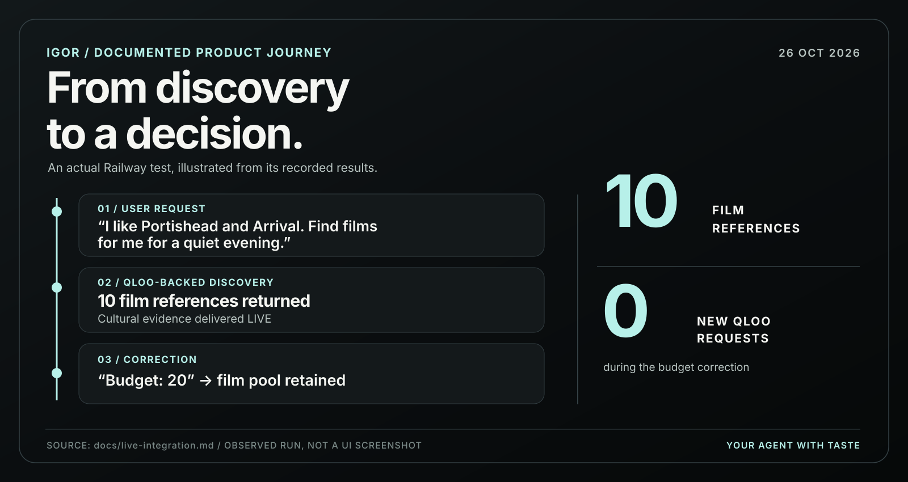
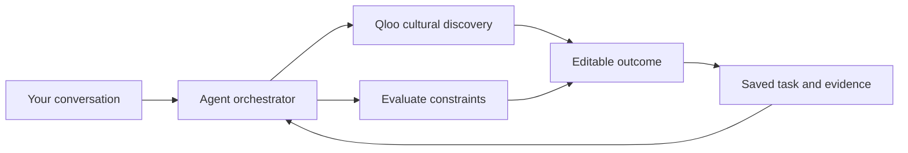

<p align="center">
  <a href="https://igor-production-243e.up.railway.app/app">
    
  </a>
</p>

<h3 align="center">AI agents are learning how to do almost anything.<br>But how do they know what's right for you?</h3>

<p align="center">
  Knowing <em>how</em> to do something isn't the same as understanding <em>what fits</em>.<br>
  Your taste. Your interests. Your people. Your constraints.
</p>

<p align="center">
  <a href="https://igor-production-243e.up.railway.app/app"><strong>Try Igor</strong></a>
  &nbsp;·&nbsp;
  <a href="#-see-igor-at-work">See it work</a>
  &nbsp;·&nbsp;
  <a href="#-get-started">Get started</a>
  &nbsp;·&nbsp;
  <a href="https://github.com/Davemafy/igor-agent">Public source</a>
</p>

---

<sub>**Submission source:** This repository preserves Igor's sanitized development history and curates the verified PR #38 engine with PR #39's landing-derived UI for review. The October 26 LIVE Qloo example below documents a prior production check, not live acceptance of this exact source revision. New UI, full release verification and the separately deployed Railway build must be evaluated independently. Archived Qloo provider-response recordings are intentionally excluded.</sub>

## 💡 Meet Igor

**What if your AI agent had taste?**

Not just the ability to suggest a film or find a restaurant, but the cultural understanding to connect your interests, make sense of different preferences, and turn ideas into something useful.

**Igor** is a conversational agent powered by [Qloo's Taste Graph](https://www.qloo.com/). Qloo provides cultural connections. Igor brings them into discovery, evaluation, group decisions, and editable work, all in one conversation.

And when you change your mind? **You don't have to start over.**

## 🎬 See Igor at work

*This isn't another list of recommendations. It's what happens after the list.*

In a documented Railway production check on **October 26, 2026**, an operator asked Igor for films connected to Portishead and *Arrival*. Igor returned ten film references with **LIVE Qloo evidence**. The operator then changed the budget. Igor updated the constraint, kept the film reference pool, and made **zero new Qloo requests** for that correction.

<p align="center">
  <a href="docs/live-integration.md">
    
  </a>
</p>

<sub>The graphic illustrates a recorded production check, rather than recreating an app screenshot. [Read the test evidence](docs/live-integration.md) or [open the application](https://igor-production-243e.up.railway.app/app).</sub>

## ✨ Four capabilities. One agent.

- 🔎 **Discover:** Explore connections across films, artists, places, and other cultural references using Qloo.
- ⚖️ **Evaluate:** Consider preferences, known facts, budgets, time, and anything still unknown.
- 🤝 **Collaborate:** Compare people's stated tastes without pretending everyone agrees.
- 🎨 **Compose:** Turn selected ideas into editable plans, invitations, itineraries, and creative briefs.

**No separate assistant for every task. No throwing away a good idea when the brief changes.**

## 🧐 Why Igor makes different decisions

<table>
<tr>
<td width="50%" valign="top">
  
  <p><strong>🔗 Show your sources.</strong><br>Qloo affinity helps Igor explore what fits. It doesn't magically verify prices, opening times, or whether someone will love the result. Igor keeps the signal, its source, and its limits together.</p>
</td>
<td width="50%" valign="top">
  
  <p><strong>🤝 Keep everyone's taste personal.</strong><br>A group isn't one taste profile. Igor preserves who's interested in what, compares signals within each query, and makes trade-offs visible instead of inventing a compatibility score.</p>
</td>
</tr>
</table>

### 🔄 Change the decision. Keep the work.

<p align="center">
  <a href="docs/live-integration.md">
    
  </a>
</p>

Change a budget and Igor can reconsider what depends on it, without restarting the cultural search. Edit an invitation and that shouldn't erase your film choices. Decisions, evidence, documents, and conversation history stay connected through versioned task state.

The same engine supports a six-person gathering, a multi-day itinerary, an artist-level listening programme, a cultural research report, and a reference-based creative brief. [See supported outcomes](docs/broader-outcomes.md).

## 🛠️ Inside Igor

We built Igor as a **Next.js and React** application with **TypeScript**, **SQLite**, typed task contracts, and server-side provider adapters. The interface and the agent work from the same saved state.



The agent interprets a request, chooses the relevant capabilities, checks evidence and constraints, then saves the result. Later changes invalidate dependent decisions while preserving unrelated work. Provider credentials remain on the server.

| Where to look | What you'll find |
| :--- | :--- |
| [Agent orchestration](src/core/orchestrator.ts) | Versioned turns, execution, and persistence |
| [Capability contracts](src/capabilities/contract.ts) | Typed discovery, evaluation, collaboration, and composition |
| [Qloo integration](src/tools/qloo-live.ts) | Cultural retrieval, identity handling, and bounded requests |
| [Evidence and revision rules](docs/architecture.md) | Provenance, constraints, stale dependencies, and selective updates |
| [Development guide](docs/development.md) | Provider configuration and verification commands |

## 💻 Get started

[**Try the live app**](https://igor-production-243e.up.railway.app/app) or clone the [**public source code**](https://github.com/Davemafy/igor-agent).

Use **Node.js 24 or newer**:

```bash
git clone https://github.com/Davemafy/igor-agent.git
cd igor-agent
npm ci
npm run dev
```

Open [localhost:3000/app](http://localhost:3000/app). For live cultural retrieval and conversation, set `QLOO_API_KEY` and a supported server-side model key such as `GEMINI_API_KEY`.

```bash
npm test
npm run typecheck
npm run build
```

The public repository excludes archived Qloo response recordings, so recorded-only replay suites aren't runnable from that checkout. [Provider setup and test details](docs/development.md) explain the available paths. App results don't imply that a venue is booked, open, or affordable unless those facts have been supplied or independently checked.

## 🔮 What's next?

🗺️ Richer spatial discovery. 📬 Permission-based coordination. 🤝 More shared reviews and approvals. 📊 Comparing outcomes with and without Qloo.

## ❤️ Thank you, Qloo

Huge thanks to the **Qloo team** for organizing this hackathon and letting us experiment with the Taste Graph. What started as a question about whether AI agents could understand taste became a much bigger exploration of culture, decisions, and creative work.

**Thank you for making it possible. ❤️**

---

<p align="center">
  <strong>🕶️ Igor. Your agent with taste.</strong><br>
  <sub>Built with ❤️ for the Qloo Agentic Hackathon.</sub>
</p>

<p align="center"><strong>Knowing what to recommend is one thing. Knowing what to do with it is another.</strong></p>