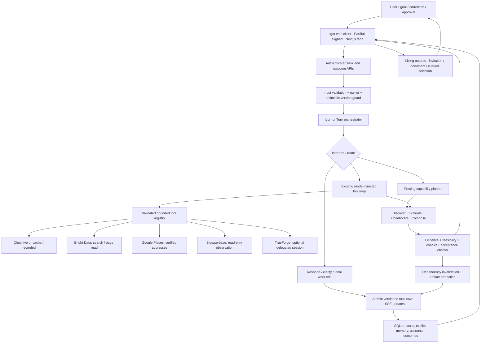
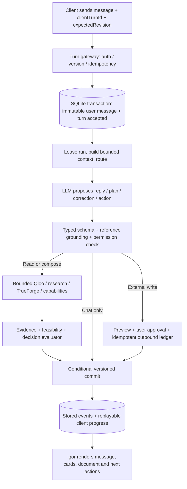
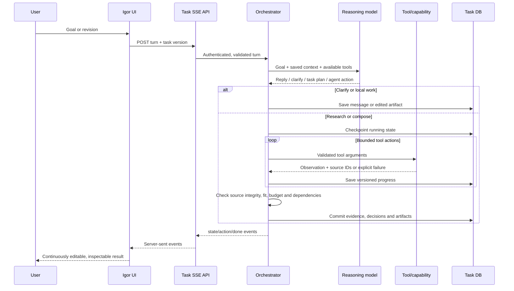
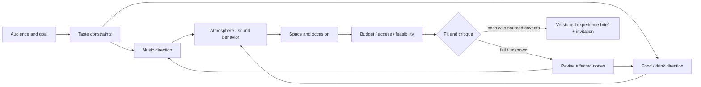
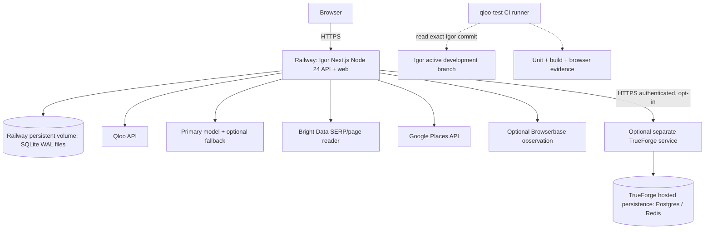

# Igor — system architecture map

**Version:** 2026-10-29 · **Target:** the single Igor development branch · **Current implementation checkpoint:** `2f725786f7a0c26a61a6064617e20929eae7efc3`

The original map below was inspected at `d4afa937d726385d23ed24e3447ad28eb21a03bb`. The following implementation status supersedes its historical P0 gap labels; proposed external-write and hosting capabilities remain proposals.

**Reliability design input:** user-provided _IGOR — System Architecture v2_, an October 26 proposal based on an older `main` tree and informed by `Enoch208/parallel`. This document folds its turn-gateway, durable journal, reference binding, action safety, proof and error semantics into the October 29 active-branch architecture. v2 was **not** an implemented migration; source-specific claims below were rechecked against the newer branch. Do not treat any proposed table or event as live.

This document distinguishes **implemented (I)**, **implemented but not proven live (V)**, **proposed (P)**, and **not supported (N)**. It is an executable architecture plan, not a claim that all services are connected or that the listening-bar workflow exists end to end.

## Current implementation status

| Contract                            | Source implementation                                                                                                              | Verification boundary                                                                                                        |
| ----------------------------------- | ---------------------------------------------------------------------------------------------------------------------------------- | ---------------------------------------------------------------------------------------------------------------------------- |
| Durable admission and idempotency   | `src/core/turn-lifecycle.ts`, `src/data/store.ts`, task turn route: atomic accepted message/journal, payload hash, revision checks | Durable-turn, turn-recovery and authenticated browser regressions                                                            |
| Replay and recovery                 | Stored ordered events, run leases/fencing, expired-run recovery; `src/components/workspace-api.ts` read-only reconnect             | Restart/expiry tests; no automatic replay of paid/external operations                                                        |
| References                          | `src/core/conversation-focus.ts`, model context, optional owned artifact context on a message                                      | Ordered current candidates; artifact selection survives reload; ambiguous/stale references are not inferred                  |
| One existing execution system       | `orchestrator.ts`, capability planner, `unified-agent.ts`, shared tool registry and acceptance                                     | Existing paths retained; no third orchestrator                                                                               |
| Experience composition and critique | `work-contracts.ts`, `connected-work.ts`, `experience-critique.ts`, registry compose/critique tools                                | Typed domain decisions, unknown costs, source/schedule/budget/restriction checks, selective invalidation and protected edits |
| Recovery operations                 | `scripts/persistence-snapshot.mjs` and `docs/operations/PERSISTENCE_RECOVERY.md`                                                   | Four-store WAL-aware backup/restore rehearsal passes; actual Railway volume configuration unverified                         |
| Actual providers                    | Qloo resolved three flagship anchors and returned 10 LIVE candidates after active-time budget fix                                  | Subsequent Gemini HTTP 503 prevented completion; no live-artifact or same-pool evaluation pass                               |
| Product journeys                    | Existing inline workspace, editable connected work, invitation studio; `scripts/verify-live-experiences.mjs`                       | Scripted/recorded desktop/mobile regressions pass; both unscripted live journeys remain blocked by model availability        |

For exact-SHA test results and unresolved release gates, use
[the implementation ledger](implementation/END_TO_END_LEDGER.md). Mocked or
recorded success is not proof of a completed live journey. TrueForge remains an
optional tested adapter; live acceptance needs a configured service.

## 0. The product invariant

**One goal → one persistent conversation and versioned work graph → relevant verified cultural and practical observations → a coherent editable experience → independent critique → selective revision.**

The engine is **goal-general**. A six-person gathering and a listening-bar concept must use the **same** state, capabilities, evaluation, source, and revision contracts. Neither vertical becomes a new app shell.

## 1. Logical architecture



**Existing runtime flow (I).** Browser work comes through the task routes and the SSE turn route. The orchestrator validates interpretation and routes either to early reply/clarification/local connected-work actions, to an ordered capability plan, or (when a research query exists and the model supports agent tool selection) to the bounded agent loop. The tool registry is **not** a universal replacement for the planner; both execution paths remain in current code. All results must ultimately respect the same saved Task schema.

**Design boundary (I).** No separate TrueForge UI, no new dashboard. Igor's own editor, provenance badges, document, invitation, and discovery views render the work. Refer to **docs/design-system.md**.

## 2. Durable conversation contract — inherited from Architecture v2 (P0)

**Implemented:** `SqliteTaskStore.acceptTurn` saves an accepted message, payload identity,
run reservation and initial journal entry in one owner-scoped transaction before
inference. Lease-fenced execution checkpoints and replayable events preserve
progress; a failure cannot erase the accepted input. Legacy task snapshots remain
readable. No paid provider calls run inside that admission transaction.



### External turn input and lifecycle

```ts
// Proposed v3 gateway envelope. Existing TurnSchema remains supported via
// compatibility parsing and must not be silently changed without migration.
type TurnEnvelope = {
  workspaceId: string;
  clientTurnId: string; // UUID generated once client-side, reused on retry
  expectedRevision: number;
  message: string;
  actionContext?: {
    activeArtifactId?: string;
    visibleCandidateIds?: string[];
    visibleResultRevision?: number;
  };
};

type TurnPhase =
  | "accepted"
  | "understanding"
  | "responding"
  | "awaiting_input"
  | "retrieving"
  | "evaluating"
  | "awaiting_approval"
  | "composing"
  | "completed"
  | "partial"
  | "failed"
  | "superseded";
```

- **Uniqueness:** `UNIQUE(workspaceId, clientTurnId)`. Matching duplicate: return saved turn/stream and **never** append the message or execute a second paid call. Same key with changed payload: reject. A newer conflicting edit marks late work superseded without replacing valid state.
- **Ordering:** in one SQLite transaction, validate owner + expected version, reserve turn and append message **before** any model call. Keep the existing Task materialized read model compatible during incremental migration.
- **State machine:** `accepted → understanding → responding|awaiting_input|retrieving|evaluating|awaiting_approval|composing → completed|partial|failed|superseded`. Persist phase and progress with a monotonically increasing per-turn event sequence.
- **Stream:** extend current `state/action/done/error` packets without breaking existing clients: `turn_accepted`, `phase`, `message_delta`, `artifact_ready`, `needs_input`, `needs_approval`, `partial`, `failed`. Client reconnects using saved turn ID/event cursor to recover the authoritative state; SSE delivery itself is **not** the persistent record.
- **Crash semantics:** a read call may be safely retried within a budget; a write action must have a reserved idempotency record and provider receipt/unknown-outcome reconciliation. A phase checkpoint without a lease/scanner does **not** imply automatic restart recovery.
- **Model fallback:** arbitrary natural language is always a valid conversational **input**, even if no matching tool or output kind exists. If the model is unavailable, save the message and communicate a visible provider failure; never fabricate a successful model reply. The existing interpreter still records a whole-turn `error` on unrecoverable model failures, so this remains a real P0 gap.

### Conversation reference registry — important for agent intelligence

Persist a `ConversationFocus` with `activeArtifactId`, `activeCandidateIds`, `ordinalMap`, `lastQuestionId`, `referencedParticipants` and `lastResultRevision`. Ground “the second one,” “that place,” “Maya's pick,” “why that one?” against **the exact visible result revision**. If the reference is stale or ambiguous, ask one question rather than guessing. The explicit focus contract is implemented in `conversation-focus.ts`; stale or absent ordered references request clarification. A bounded artifact ID on the next real message is validated against the owner-loaded task and committed atomically. Browser-only view metadata never grants evidence or execution authority.

Three distinct memories: (1) immutable thread history, (2) working goal/current focus and source-linked decisions, (3) **opt-in** long-term preferences with confirmation, scope and deletion. Prompt context must be rebuilt from these server records on every turn; neither Gemini nor TrueForge is the canonical conversation memory.

### Historical proposed table decomposition

The original proposal called for `turns` (workspace, clientTurnId, payloadHash, revision, phase), `messages` (turn, role, order, text), `run_steps` (run, phase, lease, checkpoint, budget), and `stream_events` (turn, sequence, type, JSON). Index evidence/artifact/dependency nodes as needed, **without migrating every existing Task blob first**. Use `TaskStore` compatibility methods and one Node 24 + Railway persistent volume until tested scaling constraints justify changing storage.

### Historical v2 concerns at the original inspection

This table records the original baseline. The current implementation status above supersedes its unresolved P0 labels.

| v2 claim or proposed change                                          | Rechecked on the active branch                                                                                             | Decision                                                                               |
| -------------------------------------------------------------------- | -------------------------------------------------------------------------------------------------------------------------- | -------------------------------------------------------------------------------------- |
| No clientTurnId, dedicated journal or replayable SSE event IDs       | Still absent in current `TurnSchema`, `SqliteTaskStore` and streaming route                                                | **P0 build**                                                                           |
| Whole-turn interpretation failure affects conversational reliability | `interpret-message.ts` still records `task.status = "error"` after recovery failure; a read-only conversation route exists | **P0 decouple**; preserve existing recovery logic                                      |
| “the second one” must bind to current visible result                 | Named/ID reference resolution exists; no persistent ordinal map or focus revision                                          | **P0 implement**                                                                       |
| Goal/output enums are limited                                        | `goals.ts` has gathering/discovery/creative; `outcome-spec.ts` has four specific outcome types                             | Keep typed executable outcomes; **allow general chat** independently                   |
| `count.some(saved => saved.id === saved.id)` memory-cap typo         | Active branch now correctly tests `saved.id === preference.id`                                                             | **Already fixed**; don't reintroduce bug                                               |
| Missing production-model key silently falls back to scripted         | Current runtime uses real adapters and a transparent no-model error outside fixture/test modes                             | **Improved**; retain transparent failure                                               |
| Late provider result cannot overwrite newer user edit                | Optimistic versioned Task store and isolated agent tool work copies exist                                                  | **Partially implemented**; preserve conflict checks, add run leases for crash recovery |
| Parallel-style universal taste score                                 | Not appropriate for Igor's mixed tasks                                                                                     | **Reject**; strategy-specific constraints and sourced comparisons only                 |

### Read/commit authorization boundary

For external action flows, enforce `action_proposed → validate target/owner/revision → preview recipient, scope and cost → explicit user approval → reserve idempotency key → execute → reconcile provider receipt → commit result`. Model decisions are not permissions. **Current Igor intentionally blocks external writes**; this sequence is a future contract, not a live email or booking feature.

### Proof criteria added from v2

- “hey” and “what can you do?” → genuine contextual reply, **zero Qloo**.
- “plan a weekend with friends” → useful goal or a single blocking question, not interpreter failure.
- “the second one” / “why that one?” → current focus or safely asks for disambiguation, no invented reference.
- “budget is €200” → revise only affected nodes, **no redundant Qloo calls** if source taste did not change.
- “Maya wouldn't like jazz” → participant-scoped correction, no silent durable preference save.
- Two identical retried `clientTurnId` requests → one saved turn, bounded external calls.
- Timeout/disconnect/restart → saved message survives; progress is replayable; explicitly mark interrupted if no resumable runner.
- Concurrent correction → stale write rejected; previously approved work intact.
- Provider outage → exact LIVE/CACHED/RECORDED provenance, no fabricated practical facts.
- Side-effect replay → never auto-send or claim success without approval and receipt.

## 3. Source code ownership

| Responsibility                    | Existing implementation                                                                    | Current truth                                                              |
| --------------------------------- | ------------------------------------------------------------------------------------------ | -------------------------------------------------------------------------- |
| Shell, chat, work area            | **src/components/agent-workspace.tsx**, task canvas, research discovery, invitation studio | I                                                                          |
| Task creation, fetch, turns       | **src/app/api/tasks**, **src/app/api/tasks/[id]/turn/route.ts**                            | I; SSE sends state/action/done/error                                       |
| Identity and security             | **src/core/security.ts**, **src/data/auth-store.ts**                                       | I; owner-scoped cookie/account sessions                                    |
| Intent and response               | **src/core/interpret-message.ts**, **src/core/orchestrator.ts**, model adapters            | I; live-model quality not broadly proven                                   |
| Bounded dynamic agent             | **src/core/unified-agent.ts**, **src/core/agent-tool-registry.ts**                         | I; validated tools, step/request budget and checkpoints                    |
| Capability execution              | **src/core/capability-plan.ts**, **src/core/execute-plan.ts**, **src/capabilities/**       | I; discovery/evaluate/collaborate/compose                                  |
| Cultural data                     | **src/tools/qloo-live.ts**, **qloo-response.ts**, **recorded-qloo.ts**, **qloo-cache.ts**  | I; live freshness must be verified                                         |
| Search & real-world data          | **src/tools/live-research.ts**, **google-maps.ts**, **browserbase-observer.ts**            | I adapters; credentials/provider success unconfirmed                       |
| Delegation                        | **src/tools/trueforge.ts**                                                                 | V; disabled by default, mocked API tests only                              |
| Contract + critique               | **src/core/contracts.ts**, **agent-acceptance.ts**, **src/capabilities/evaluate.ts**       | I; compositional experience critique is still incomplete                   |
| Durable edits and dependencies    | **src/core/connected-work.ts**, **connected-artifacts.ts**, **revision.ts**                | I; broader cross-domain dependency graph requires expansion                |
| Durable task state                | **src/data/store.ts**                                                                      | I; SQLite tasks + explicitly confirmed memory                              |
| Auth, sharing, collection, review | **src/data/auth-store.ts**, **outcome-store.ts**, **src/core/outcomes.ts**                 | I; not email/calendar external execution                                   |
| Presentation                      | **src/components/invitation-studio.tsx**, **liquid-discovery.tsx**                         | I; current design review contract is Partiful-based                        |
| Real cross-app write actions      | **src/core/connected-work.ts**                                                             | N; external actions explicitly record _blocked_, nothing is sent or booked |

## 4. Task state = system of record

The durable unit is a **Task** (owner-scoped), **not** a TrueForge session, a chat completion, or a browser view. Each Task carries:

- **Intent:** goal, participants/preferences, constraints, location, selection and unresolved requirements.
- **Conversation:** user and assistant messages with identities, plus a saved work/presentation surface.
- **Observation:** Qloo entities, cultural candidates, evidence records and per-query provenance; web source observations; practical unknowns.
- **Work:** proposed/approved/rejected decisions and documents; independent artifacts; versions, explicit edits, dependency links and traces.
- **Execution:** current and archived agent runs, tool receipts, budgets, activity and optional delegated TrueForge session ID.

**Single writer rule (I):** every edit supplies an expected task version. The server checks owner and version, checkpoints before slow provider calls, rejects conflicting writes and does not overwrite newer changes with late results. Independent side effects require separate idempotency and user authorization (P).

**Memory distinction:** confirmed preference memory exists (I); a long-lived, proactive assistant with a scheduler and cross-goal follow-up does **not** (N). Resuming a task uses Igor's saved Task, not a provider's conversation as the sole source of truth. The TrueForge session ID is a subordinate execution context.

## 5. Agent's decision and execution loop



**Guardrails already in code:** origin/owner checks, bounded request body, typed decisions, one bounded repair for malformed model output, finite agent actions, no model-chosen URLs for search-page reads, process-local request limits, optimistic versioned persistence, source-aware evidence checks, and protection against rewriting manually edited/approved work.

**Operational gap (P):** add durable run leases/checkpoints to recover safely after container restarts or duplicated requests, correlation IDs, and shared per-owner quota for multi-instance deployment. Do not treat process-local caps as globally enforced.

## 6. The composition layer we must complete

Gastro-Acoustic must be a **reusable experience graph** layered over existing connected work, not a one-off prompt template.



**Proposed experience records (P):**

- **ExperienceGoal:** audience, use case, intent, known and unknown constraints.
- **DecisionNode:** domain = music | food | atmosphere | space | identity | operations; chosen value; alternatives; justification; confidence; estimated cost or unknown; approval state.
- **EvidenceLink:** immutable provider/candidate/source references with original timestamps, delivery mode, limitations and whether evidence is cultural versus practical.
- **DependencyEdge:** which decisions and authored sections must become _stale_ when a constraint changes.
- **ExperienceArtifact:** editable launch brief, timeline, invitation, shortlist, menu/sound direction and explicit unresolved questions.

**Boundary rule:** Qloo affinities support a _cultural_ connection, never venue availability, dietary suitability, actual acoustical performance, price, a booking, or a personal psychological claim. The model may propose a coherent pairing but should mark unsupported parts as interpretation. Critique must independently reject missing or contradictory inputs instead of praising everything.

**Implemented, not proven live end to end:** the typed experience fields, composition tools and deterministic independent critique now exist in `work-contracts.ts`, `connected-work.ts`, `agent-tool-registry.ts` and `experience-critique.ts`. Linked decisions, budget/schedule/restriction/source checks and protected selective revision have regression coverage. Live cross-domain artifact completion remains blocked by Gemini availability.

## 7. Proposed hosting topology — minimum credible production



**P0 hosting topology:** one Igor Node 24 app instance, TLS and a Railway persistent volume containing **the workspace, account, outcome and Qloo cache SQLite files together**, with scheduled backups **including WAL** and a tested restore. Mount before any real user data is collected. Verify actual volume and backup configuration; the presence of SQLite in code does not establish that the deployed Railway app is durable. If multiple replicas are required later, migrate to a shared database and shared quotas first—do not share SQLite WAL across multiple containers.

**P0 keys:** server-only QLOO_API_KEY and one model credential plus optional fallback. For sourced practical-world lookup, BRIGHTDATA_API_KEY with SERP zone and GOOGLE_MAPS_API_KEY. Configure only where the corresponding capability is exercised. Never place keys in NEXT_PUBLIC_* or commit fixture secrets.

**P1 optional:** TrueForge service with its own authenticated endpoint, named agent and model provider; only then enable IGOR_TRUEFORGE_ENABLED, TRUEFORGE_BASE_URL, TRUEFORGE_AGENT_NAME, remote TRUEFORGE_TOKEN. Local no-login TrueForge must remain loopback-only. Browserbase is an optional read-only observer; not a cross-app acting connector. OAuth, scheduled proactive activities and execution of external writes are deferred and need user consent, authorization scopes, idempotency, rollback and audit.

**CI (I):** qloo-test's single-branch workflow reads Igor's current active development SHA and runs static checks, unit suite, build, and recorded Chromium journeys. It executes on qloo-test push, manual workflow dispatch or periodic schedule; Igor push does **not** automatically invoke qloo-test as an ordinary same-repository push trigger. Repo-wide formatting remains nonblocking debt. Igor's own Actions runners were failing before job steps. Do not conflate this with a failing application build.

## 8. The two required acceptance journeys

| Gate                    | Six-person gathering                               | Listening bar                                                      |
| ----------------------- | -------------------------------------------------- | ------------------------------------------------------------------ |
| Open-ended first turn   | Starts from ordinary natural language              | Starts from founder, audience, finite budget                       |
| True cultural retrieval | Qloo-derived film/music/artist choices, source IDs | Cross-domain artist/place/brand signals actually supported by Qloo |
| Practical grounding     | Timings, group budget, access unknowns             | Actual venues or market signals, cost/permit/acoustic unknowns     |
| Composition             | Feasible programme + editable invitation           | Sound/menu/space/identity concept + launch brief                   |
| Critique                | Group compatibility and contradictions             | Audience fit, conflicting themes, budget feasibility               |
| Revision                | Friend dislikes music: revise affected choices     | Half budget/no alcohol: revise affected choices only               |
| Persistence             | Reload, continue thread and retain protected edits | Reload, retain approved positioning and source links               |
| Proof                   | LIVE provider trace, actual browser captures       | Independent second goal using same interfaces and engine           |

For every gate: verify **actual** provider calls separately from CACHED/recorded demo mode. Do not call a cached screenshot proof of live execution. Where no live data is available, render explicit unknowns.

## 9. Implementation sequence and release gate

1. **P0 durable turn gateway first:** add clientTurnId + transactional accepted-turn/message journal, replayable phase/event stream, version guard, reference focus and safe arbitrary-chat fallback. Then verify owner-scoped unscripted messages, live Qloo and model calls, source-backed drafts, reload, correction and preserved edits. Model/provider failures must retain the saved input.
2. **Establish durable deployment:** Railway volume, four paths, backups and restored test task; server-only secrets; single replica; deny unwanted external writes.
3. **Implement the experience graph within existing Task / WorkState:** typed domain nodes and dependency links, per-edge evidence/interpretation, independent fit/feasibility critique, selective invalidation with approval protection. Avoid a new app or DB for Gastro-Acoustic.
4. **Run both demonstrations on identical engine and product surface:** live and recorded paths explicitly distinct; manual user verdict and screenshots on desktop/mobile.
5. **Optional TrueForge live A/B:** compare latency, continuity, costs, tool behavior and completion on identical input; only promote it beyond an optional tool if it demonstrably outperforms the existing loop.
6. **CI before merge:** strict relevant formatting, TS, lint, full unit suite, evaluation, production build, both main browser journeys, live-provider acceptance, release health and screenshots at the **same** SHA. Keep PR #27 draft until checked and authorized.

### What not to build right now

No new Igor branches; no second chat application; no universal HUD or AI-generic UI; no automatic external purchases/bookings; no fabricated Qloo recommendations or pretend Gastro-Acoustic correlations; no unverified Redis/Postgres migration, vector database or queue merely for architecture appeal.

### Critical design choice

**Igor's Task + evidence + dependency graph remain the product's source of truth. The model and TrueForge propose; providers observe; capability evaluators validate; the user approves; Igor persists.** Everything else is a replaceable implementation detail.
