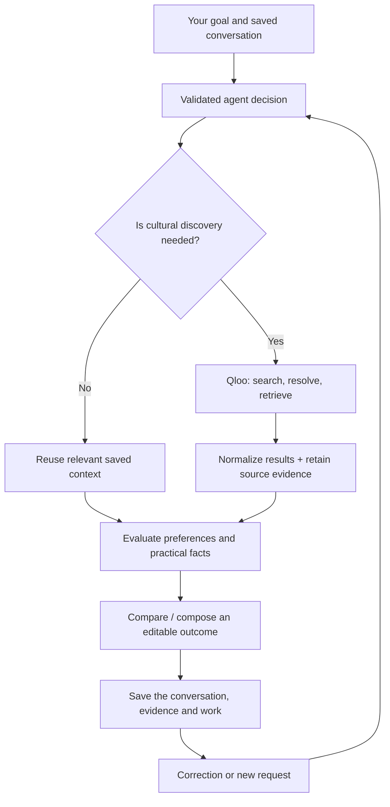

# 🔎 From taste to a decision

Igor uses Qloo as a capability in one persistent conversation. The user doesn't have to know Qloo's API or decide which tool to open.

## The path through Igor

The orchestrator chooses the relevant capabilities. Provider adapters remain on the server, and tasks are versioned in SQLite. Models don't receive permission to invent tool names, URLs or privileged actions.

## 1. Retrieve cultural references

The live provider in [`src/tools/qloo-live.ts`](../src/tools/qloo-live.ts) calls fixed Qloo endpoints including `/search` and `/v2/insights`. It bounds requests, uses a cache, and passes the response to [`src/tools/qloo-response.ts`](../src/tools/qloo-response.ts) for validation and normalization.

A cache hit is labeled `CACHED`. A fresh provider result can be labeled `LIVE`. Retaining delivery type, retrieval time, entity identity, relevant seeds and limitations helps prevent an old result from being presented as a newly verified answer.

## 2. Keep cultural and practical evidence apart

Qloo can suggest cultural affinity. Cost, duration, venue availability, access and licensing are separate facts. If a user hasn't supplied them and Igor hasn't independently verified them, they remain unknown. A group comparison keeps each person's stated preference attributed to that person; unknown is not treated as dislike.

See [`docs/architecture.md`](../docs/architecture.md) for the evidence and evaluation contracts.

## 3. Make something useful

Igor's shared capabilities cover discovery, evaluation, collaboration and composition. Supported outcomes include a gathering programme and invitation, an itinerary, an artist-level listening programme, a research report or a creative brief. The supported scope and limits are in [`docs/broader-outcomes.md`](../docs/broader-outcomes.md).

## 4. Revise without restarting everything

A budget correction can re-evaluate a saved reference pool without querying Qloo again. A taste or location change can invalidate the dependent cultural research. A wording-only document edit doesn't need to trigger discovery. Stale evidence must not silently appear current.

The [October 26 Railway checks](EVIDENCE.md) observed zero new Qloo requests when a budget correction retained an existing film pool. That is a documented run, not a claim that every possible prompt behaves identically.

## 5. Fail without making up an answer

Provider errors, malformed model decisions, unknown practical facts and unavailable recordings are separate failure cases. Saved decisions must not be replaced by invented results when a provider cannot return data.

[Inspect the live adapter](../src/tools/qloo-live.ts) · [Read production checks](../docs/live-integration.md) · [See test setup](EVALUATION.md)
